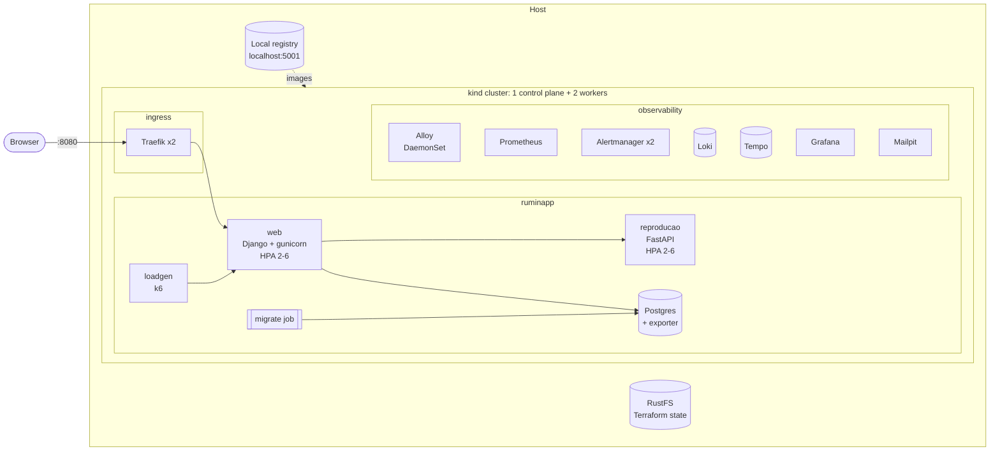
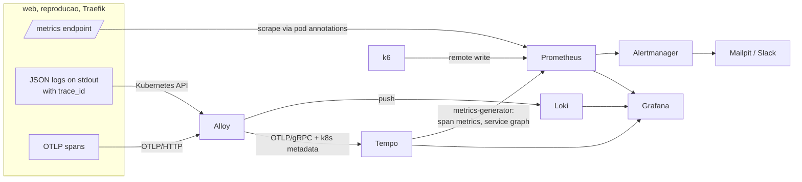

# RuminApp Platform

A local Kubernetes platform, built entirely with Terraform, that runs **RuminApp** (a dairy herd
management app) with metrics, logs, traces, alerting, SLOs and cost tracking.

```bash
make deps   # install Docker, kind, kubectl, Terraform and Helm (macOS and Linux)
make up     # create everything and run the smoke test
```

`make up` takes 10 to 15 minutes on a clean machine, most of it pulling images. At the end it prints the URLs and credentials:

| What | URL |
|---|---|
| RuminApp | http://ruminapp.localtest.me:8080 |
| Grafana | http://grafana.localtest.me:8080 |
| Prometheus | http://prometheus.localtest.me:8080 |
| Alertmanager | http://alertmanager.localtest.me:8080 |
| Mailpit (alert e-mails) | http://mail.localtest.me:8080 |

`localtest.me` is a public DNS name whose subdomains all resolve to `127.0.0.1`, so no `/etc/hosts`
changes are needed. Run `make credentials` at any time to print the passwords again, and
`make down` to remove everything.

## Contents

- [Requirements](#requirements)
- [Architecture](#architecture)
- [Repository layout](#repository-layout)
- [Infrastructure as code](#infrastructure-as-code)
- [The application](#the-application)
- [Observability](#observability)
- [Security](#security)
- [Resilience](#resilience)
- [Things to try](#things-to-try)
- [Design decisions and trade-offs](#design-decisions-and-trade-offs)
- [Troubleshooting](#troubleshooting)

## Requirements

- macOS, or a Linux distribution from the Debian, Ubuntu, Amazon Linux 2/2023, Fedora or RHEL families.
- Docker with **8 GB of memory** and 4 CPUs. Machines with ~6 GB can use the smaller profile:
  `ENVIRONMENT=small make up`.
- About 15 GB of free disk for images and volumes.

`make deps` (`scripts/install-deps.sh`) installs pinned versions of kind, kubectl, Terraform and Helm,
verifying each download against its published SHA-256. On Linux it also installs Docker from the
distribution packages and raises the inotify limits that multi-node kind clusters need. On macOS it
uses an existing Docker Desktop, OrbStack or Colima, and installs Colima when there is none.

## Architecture



### How telemetry flows



Signals are linked to each other in Grafana:

- **Metrics to traces**: the HTTP latency histograms carry exemplars with the `trace_id`. The dots in
  the latency panels open the trace of that exact request.
- **Logs to traces**: Alloy stores `trace_id` as Loki structured metadata, and the Loki data source
  turns it into a link to Tempo.
- **Traces to logs and metrics**: from a span, Grafana jumps to the logs of the same pod and trace,
  and to the span metrics of the same service.
- **Service map**: the Tempo metrics-generator builds a service graph (Traefik → web → reproducao,
  web → Postgres) shown as a node graph.

## Repository layout

```
app/        RuminApp source code and its Terraform deployment
  web/          Django UI (the original RuminApp) - Python, Dockerfile, tests
  reproducao/   reproductive rules engine extracted into a FastAPI service
  loadgen/      k6 script that drives realistic traffic
  deploy/       Terraform module: images, Postgres, services, HPA, PDB, NetworkPolicies, ingress
o11y/       observability stack
  module/       Terraform module: Prometheus, Alertmanager, Grafana, Loki, Tempo, Alloy, Mailpit
  values/       Helm values (templated by Terraform)
  rules/        recording and alerting rules: SLOs, cost, application
  dashboards/   Grafana dashboards, one folder per Grafana folder
  alloy/        Alloy pipeline (logs and traces)
infra/      cluster and platform
  stacks/cluster/    root module: kind cluster and local registry
  stacks/platform/   root module: wires addons, o11y, app and RBAC together
  modules/           kind-cluster, cluster-addons, access-control
  environments/      backend config and tfvars per environment (local, small)
scripts/    install, up/down, smoke test, Terraform wrapper, RBAC helper
Makefile    entry point for everything above
.github/    CI: terraform fmt/validate, shellcheck and unit tests
```

## Infrastructure as code

Everything that runs in the cluster, including Helm releases, dashboards, alert rules, secrets and
container images, is declared in Terraform. The shell scripts only sequence `terraform` commands and
check prerequisites.

**Two stacks.** `infra/stacks/cluster` creates the kind cluster. `infra/stacks/platform` reads the
cluster credentials from the first stack's remote state and installs everything else. Keeping them
apart avoids configuring the Kubernetes and Helm providers from a resource created in the same
apply, which the Terraform docs advise against, and lets the platform be re-applied or destroyed
without touching the cluster.

**Modules.**

| Module | Responsibility |
|---|---|
| `infra/modules/kind-cluster` | kind cluster (pod/service CIDRs, zone labels on the workers, ingress port mapping) and a local image registry wired into containerd |
| `infra/modules/cluster-addons` | Traefik ingress controller, metrics-server, a `Retain` StorageClass, a platform PriorityClass |
| `infra/modules/access-control` | RBAC for platform admins, developers and auditors |
| `o11y/module` | the observability stack, dashboards, rules, Mailpit |
| `app/deploy` | builds and pushes images, deploys Postgres, runs migrations, deploys the services and load generator |
| `app/deploy/modules/service` | reusable Deployment + Service + HPA + PDB + ServiceAccount used by both services |

**Remote state.** State is stored in an S3 bucket served by [RustFS](https://rustfs.com), running as
a container outside the cluster (it has to exist before the first `terraform init`).
`scripts/state-backend.sh` starts it, generates the access keys into `.data/state-backend.env` and
creates the bucket. Locking uses the S3 backend's native lock file (`use_lockfile = true`), so no
DynamoDB-like service is needed. The RustFS console is at http://127.0.0.1:9901.

**Environments.** `infra/environments/<env>/{cluster,platform}.tfvars` hold the per-environment
values, and each environment gets its own state keys (`<env>/cluster.tfstate`,
`<env>/platform.tfstate`):

| | `local` (default) | `small` |
|---|---|---|
| HPA min/max | 2-6 | 1-3 |
| Alertmanager replicas | 2 | 1 |
| Retention (metrics/logs/traces) | 7d / 7d / 3d | 2d / 2d / 1d |
| Latency SLO threshold | 500 ms | 1 s |
| Trace sampling | 100% | 50% |

To run Terraform directly with the right backend and variables:

```bash
scripts/tf.sh platform plan
ENVIRONMENT=small scripts/tf.sh platform apply
```

**Images without a remote registry.** Terraform builds the two service images with the Docker
provider and pushes them to a registry container on `localhost:5001`. The kind nodes pull from that
same address through a containerd mirror (`hosts.toml`). Image tags are a hash of the source tree,
and pods reference the pushed **digest**, so any code change produces a new rollout and nothing
depends on `:latest`.

## The application

RuminApp is a Django app for managing a dairy herd: animals, calvings, heats, inseminations,
pregnancy checks, drying-off. Each cow's reproductive status is not stored. It is recomputed from
her event history every time, and the app's main screen lists the day's actions (cows to watch for
heat, pregnancy checks due, cows to dry off, expected calvings).

The original app was a monolith on SQLite. For this platform it was split into:

| Service | Stack | Role |
|---|---|---|
| `web` | Django 5.2, gunicorn | UI, authentication, persistence. Sends each cow's events to `reproducao` in one batch request per page. |
| `reproducao` | FastAPI | Stateless rules engine (`motor.py`): turns events into status, forecasts and alerts. |
| `postgres` | Postgres 17 StatefulSet | Replaces SQLite, which cannot be shared across replicas. |
| `loadgen` | k6 | Logs in and browses like a user: dashboard, filtered lists, animal pages, occasional event registration. |

The data is synthetic. On first deploy the `migrate` job applies migrations, creates the admin and
load generator users from Kubernetes secrets, and generates a herd of about 120 animals with ~900
consistent events (`manage.py preparar`).

Both services emit:

- **Metrics**: `http_server_request_duration_seconds` (histogram with `trace_id` exemplars) and
  business metrics such as `reproducao_animais_calculados_total`, `reproducao_alertas_total{codigo}`
  and `ruminapp_reproducao_falhas_total`.
- **Logs**: one JSON line per request with method, route, status, duration and `trace_id`/`span_id`.
- **Traces**: OpenTelemetry for Django, FastAPI, `requests` and `psycopg`, exported over OTLP/HTTP.

When `reproducao` is unreachable, `web` answers with a 503 page instead of a stack trace and counts
the failure, which feeds an alert.

## Observability

All components are installed by `o11y/module` from upstream Helm charts:

| Component | Chart | Notes |
|---|---|---|
| Prometheus, Alertmanager, Grafana, kube-state-metrics, node-exporter | `prometheus-community/kube-prometheus-stack` | remote write receiver and exemplar storage enabled |
| Loki | `grafana-community/loki` | monolithic mode, filesystem storage, 7-day retention |
| Tempo | `grafana-community/tempo` | metrics-generator for span metrics, service graph and TraceQL metrics |
| Alloy | `grafana/alloy` | DaemonSet: pod logs and OTLP gateway |
| Mailpit | plain Deployment | local SMTP server and inbox for alert e-mails |

### Dashboards

Grafana is provisioned with the kube-prometheus-stack dashboards (folder *Kubernetes*) and five
custom ones:

| Folder | Dashboard | What it answers |
|---|---|---|
| RuminApp | **Overview** | Golden signals per service, latency per route with exemplars, business metrics, HPA replicas, CPU/memory per pod, Postgres, log volume, error logs, service map, slow traces, k6 client-side latency |
| RuminApp | **SLOs** | SLI over the window, error budget remaining, multi-window burn rates, active SLO alerts |
| Platform | **Cluster health** | Node and pod status, restarts, CPU/memory by node, request allocation, PVC usage, API server errors, firing alerts |
| Platform | **Cost and efficiency** | Hourly and monthly cost by namespace, idle cost, reserved vs. used CPU and memory, most expensive pods |
| Platform | **Observability pipeline** | Ingestion rates of Loki, Tempo and Prometheus, Alloy export failures, discarded logs, scrape targets down |

### SLOs

Two SLOs per service, computed from the same histogram the dashboards use (`o11y/rules/slo.yaml.tftpl`):

| SLO | Definition | Target (local) |
|---|---|---|
| Availability | requests not answered with 5xx | 99.5% over 7 days |
| Latency | requests answered in under 500 ms | 99% over 7 days |

The window matches Prometheus retention. Alerts follow the multi-window, multi-burn-rate method from
the Google SRE Workbook: critical at 14.4x (1h and 5m) and 6x (6h and 30m), warning at 3x (1d and 2h)
and 1x (3d and 6h). Targets, threshold and window are Terraform variables (`slo` in the tfvars).

### Alerts

Besides the kube-prometheus-stack defaults, `o11y/rules` adds the SLO burn-rate alerts and:

| Alert | Fires when |
|---|---|
| `RuminappReproducaoUnavailable` | `web` keeps failing to call `reproducao` |
| `RuminappHPAAtMaxReplicas` | an HPA stays at its maximum for 15 min |
| `RuminappPostgresDown` / `RuminappPostgresConnectionsHigh` | the database is unreachable or above 80% of `max_connections` |
| `RuminappNoTraffic` | `web` receives nothing for 15 min |
| `LokiDiscardingLogs`, `AlloyTraceExportFailing`, `PrometheusRemoteWriteRejected` | the telemetry pipeline itself is losing data |

Notifications go to Mailpit by e-mail (open http://mail.localtest.me:8080). Critical alerts can also
go to Slack by setting `slack_webhook_url`:

```bash
TF_VAR_slack_webhook_url=https://hooks.slack.com/services/... make up
```

### Cost tracking

There is no cloud bill locally, so cost is modelled with recording rules (`o11y/rules/cost.yaml.tftpl`)
using the same default prices as OpenCost for clusters without a provider (USD 0.031611 per vCPU-hour,
0.004237 per GiB-hour of memory, 0.04 per GiB-month of storage). A namespace's allocated cost is the
larger of its requests and its actual usage; idle cost is requested capacity that went unused. Prices
are the `pricing` variable of `o11y/module`.

## Security

**RBAC** (`infra/modules/access-control`). Three groups, meant to map to an identity provider:

| Group | Access |
|---|---|
| `platform-admins` | `cluster-admin` |
| `ruminapp-developers` | in `ruminapp`: read workloads, read logs, port-forward, delete pods, scale and restart deployments. **No** secrets, RBAC or NetworkPolicy changes. Read-only in `observability`. |
| `auditors` | read-only across the cluster (aggregated from `view`, plus nodes, PVs and StorageClasses), no secrets |

To try it, issue a client certificate signed by the cluster CA for a user in a group:

```bash
make user NAME=ana GROUP=ruminapp-developers
KUBECONFIG=.data/users/ana.kubeconfig kubectl auth can-i --list -n ruminapp
KUBECONFIG=.data/users/ana.kubeconfig kubectl get secrets -n ruminapp   # Forbidden
```

Workload identities follow the same idea: application pods do not mount service account tokens, and
Alloy's ClusterRole was reduced from the chart default (which can read secrets) to pods, logs,
namespaces, nodes and ReplicaSets.

**NetworkPolicies** (`app/deploy/network-policies.tf`). The `ruminapp` namespace denies all ingress
and egress by default; then each flow is allowed explicitly:

| From | To | Port |
|---|---|---|
| Traefik (`ingress` ns), loadgen | web | 8080 |
| web | reproducao | 8080 |
| web, migrate job | postgres | 5432 |
| web, reproducao | Alloy (`observability` ns) | 4318 |
| Prometheus (`observability` ns) | all app pods | 9464, 9187 |
| loadgen | Prometheus | 9090 (k6 remote write) |
| all pods | CoreDNS | 53 |

kind's default CNI (kindnet) enforces NetworkPolicies, so these are effective. A pod in another
namespace cannot reach `web` or `postgres`, and `web` cannot reach Grafana.

**Pod Security Admission.** `ruminapp` and `ingress` enforce the `restricted` profile. Every container
runs as non-root with a read-only root filesystem, no capabilities, no privilege escalation and the
`RuntimeDefault` seccomp profile. `observability` enforces `baseline`, and node-exporter, which needs
host namespaces, runs alone in `observability-node` with `privileged`.

**Secrets.** Passwords (Django secret key, Postgres, app users, Grafana admin) are generated by
Terraform's `random_password` and stored as Kubernetes Secrets. Nothing secret is committed, and
the Slack webhook is a sensitive variable. The trade-off is discussed below.

## Resilience

- **Requests and limits** on every container, plus a `LimitRange` with defaults and a
  `ResourceQuota` in the app namespace.
- **Probes**: startup, readiness (`/readyz` checks the database for `web`) and liveness (`/healthz`).
  Postgres uses `pg_isready`.
- **HPA** on CPU for `web` and `reproducao` (2-6 replicas), with a fast scale-up and a slower,
  stabilised scale-down. `make load VUS=30` makes it scale.
- **PodDisruptionBudgets** for `web`, `reproducao`, Traefik and Alertmanager (created only when there
  is more than one replica, so they never block a drain).
- **Spreading**: topology spread constraints across nodes and across the two worker "zones".
- **Graceful shutdown**: a `preStop` delay so endpoints are removed before the process stops, and
  rolling updates with `maxUnavailable: 0`.
- **Priority**: observability, ingress and database pods use a `platform-critical` PriorityClass.
- **Retained data**: Postgres uses a StorageClass with `reclaimPolicy: Retain`.

## Things to try

| Command | What to watch |
|---|---|
| `make chaos ERROR_RATE=0.3` | `reproducao` fails 30% of requests (`web` retries, so only part of it reaches users). The SLOs dashboard shows the burn rate climbing; after about 15 minutes `SLOAvailabilityBurnRateCritical` fires for `reproducao` and an e-mail arrives in Mailpit. Error logs in the Overview link straight to the failing traces. `make chaos-off` restores it. |
| `make chaos ERROR_RATE=0 LATENCY_MS=1500` | Same for the latency SLO. Exemplars on the latency panel point to the slow traces. |
| `make load VUS=30` | `web` CPU rises and the HPA adds replicas (Overview → *Capacity and autoscaling*). `make up` returns to the configured load. |
| `make user NAME=ana GROUP=auditors` | RBAC from a real client certificate. |
| `make smoke-test` | Checks app, data sources, metrics, logs, traces, trace propagation and alerting end to end. |
| `kubectl drain <worker> --ignore-daemonsets --delete-emptydir-data` | Pick the worker that is **not** running `postgres-0` (local-path volumes are bound to their node). Evictions respect the PDBs, so `web` and `reproducao` keep serving with no 5xx while pods move to the other worker. `kubectl uncordon <worker>` afterwards. |

`make chaos` and `make load` are Terraform applies with an extra `-var`, so the next `make up`
puts the declared configuration back.

## Design decisions and trade-offs

**kind over k3d/minikube.** Multi-node clusters with real node containers, zone labels, port mappings
and containerd configuration are all declarative in the kind config, and the `tehcyx/kind` provider
manages it from Terraform. kindnet enforces NetworkPolicies, so no extra CNI is needed for this scope.
A production cluster would use Cilium or Calico for richer policies and network observability.

**Two Terraform stacks instead of one.** Discussed above. The cost is one extra `terraform apply`,
which `make up` hides.

**RustFS for remote state.** MinIO no longer publishes container images. RustFS is an
Apache-2.0, S3-compatible server that supports the conditional writes the S3 backend's lock file
needs. Any S3-compatible endpoint works by changing `scripts/state-backend.sh`.

**Annotation-based scraping instead of ServiceMonitors.** The Prometheus Operator CRDs are installed
by the same apply that would create the ServiceMonitors, and `kubernetes_manifest` needs the CRD to
exist at plan time. A `kubernetes-pods` scrape job driven by `prometheus.io/*` annotations avoids
that ordering problem and keeps the app module independent of the operator. The charts' own
ServiceMonitors still work as usual.

**Alloy as a DaemonSet reading logs through the Kubernetes API.** Each instance tails only the pods on
its node, so there is no duplication and no hostPath mount, and the containers stay non-root with a
read-only filesystem. Tailing files from `/var/log/pods` scales better and would be the choice for
high log volumes. Apps send OTLP to the Alloy instance on their own node (`internalTrafficPolicy:
Local`), which also lets the `k8sattributes` processor identify the source pod.

**Monolithic Loki and single-binary Tempo on filesystem storage.** This is enough for one node's worth
of data and keeps memory use low. At scale both would run in distributed mode on object storage.
Loki and Tempo come from the `grafana-community` chart repository, where those charts are maintained now.

**Postgres as a plain StatefulSet.** One replica with an exporter sidecar is enough to demonstrate
persistence. Its volume comes from kind's local-path provisioner, so it is tied to one node: draining
that node takes the database down. A real deployment would use replicated storage and an operator such
as CloudNativePG for HA, backups and failover.

**Secrets in Kubernetes Secrets, generated by Terraform.** Simple, nothing sensitive in Git, and the
values never appear in the plan output. The downside is that they live in the Terraform state, which
here is a private bucket on localhost. In production I would keep the source of truth in a secret
manager (Vault, AWS Secrets Manager) and sync it with External Secrets Operator, or use Sealed
Secrets for a GitOps flow.

**Latency SLO: 99% under 500 ms, set from measurements.** On the first deploy the dashboard and list
pages had a p95 close to 0.9 s and only ~94% of requests finished under 500 ms. The traces showed
almost all of the time was CPU spent rendering the whole herd, not database or `reproducao` calls,
and the per-pod metrics showed one `web` pod doing most of the work. Two causes: k6 kept its
connections open, so each virtual user stuck to one pod, and a 150m CPU request made the HPA react
late. After disabling connection reuse in k6 and raising the request to 250m, 99.5% of requests finish
under 500 ms (p95 of the dashboard page ~230 ms), so that became the SLO. The `small` environment,
with fewer replicas, uses 1 s.

**One gunicorn worker per pod.** The Python services run one process per container with a few
threads, and scale horizontally through the HPA. This keeps the Prometheus client simple (no
multiprocess mode) and makes CPU-based autoscaling meaningful.

**HTTP only.** Everything is bound to `127.0.0.1` and served over plain HTTP on `localtest.me`.
cert-manager with a local CA would be the next step.

**Service mesh not implemented.** It was optional and I chose to spend the time on the observability
and security parts. With a mesh (Istio ambient or Linkerd) mTLS, retries and canary releases would
move out of the application, and the mesh would export its own spans to the same Alloy → Tempo
pipeline.

**Other next steps:** GitOps (Argo CD) for the in-cluster resources, CloudNativePG, TLS, External
Secrets, and an e2e job in CI that runs `make up` with `ENVIRONMENT=small` on a GitHub runner.

## Troubleshooting

| Symptom | Fix |
|---|---|
| `make up` says port 8080 is in use | Change `ingress_http_port` in `infra/environments/<env>/cluster.tfvars`. |
| Pods stuck in `Pending` or OOMKilled | Give Docker more memory, or use `ENVIRONMENT=small`. |
| Loki rejects logs with "Ingester is shutting down" | Disk is above 90%. Free space in Docker (`docker system prune`) or on the host. |
| `*.localtest.me` does not resolve | Some corporate DNS servers block it. Add `127.0.0.1 ruminapp.localtest.me grafana.localtest.me prometheus.localtest.me alertmanager.localtest.me mail.localtest.me` to `/etc/hosts`. |
| Linux: `permission denied` on the Docker socket | Log out and back in after `make deps` (your user was added to the `docker` group). |
| Want to start over | `make purge` removes the cluster, the state backend and `.data/`. |
